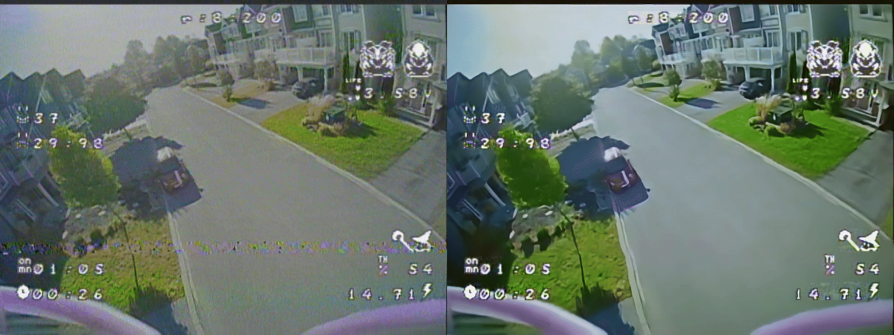
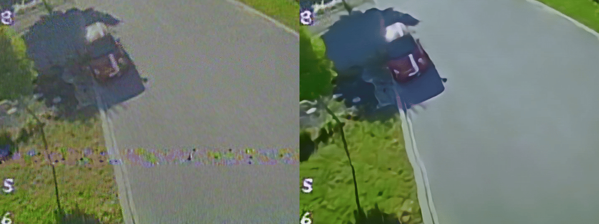
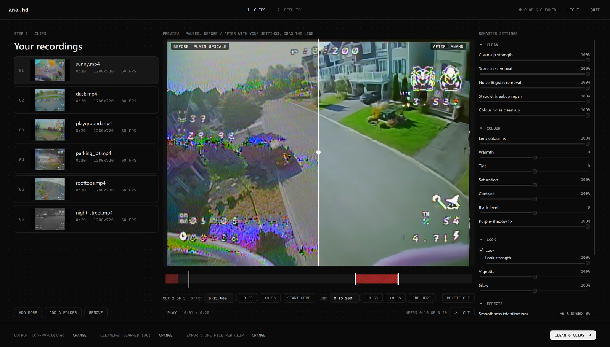

# AnaHD

Turns analog FPV goggle DVR recordings into clean HD video, offline, on an NVIDIA GPU.

Analog FPV video is soft, grainy and full of transmission damage: rolling scan-line bands,
rainbow colour snow, dropped colour, sparkle. AnaHD repairs that damage from the
neighbouring frames, cleans and upscales the picture with a small video network distilled
from a large diffusion restorer, and keeps the OSD readable. Nothing is uploaded; it all
runs on your PC.

**[⬇ Download AnaHD for Windows](https://github.com/dominic-salas/AnaHD/releases/latest)**  ·  [Project page](https://dvsalas.com/anahd)

<p align="center"></p>
<p align="center"></p>

Left: the recording's picture area upscaled with plain Lanczos. Right: AnaHD. Same frame of a
daytime flight, with a breakup band across the lower third. Lower: a 1:1 crop of that
frame at 1440x1080.

> **Built for one pilot's gear.** AnaHD is a personal tool, shared as is. Its learned
> model was trained on one camera, one video link and one DVR, so on your footage it may
> look different, for better or worse. Read [what that means for you](#made-for-one-setup-what-that-means-for-yours)
> before judging it, and compare with the **Classic** cleaning, which does not depend on
> the training footage.

## Download

**[Download the latest installer](https://github.com/dominic-salas/AnaHD/releases/latest)**
(`AnaHD-<version>-setup.exe`, under Assets) and run it. It installs for your user (no
admin rights), offers a desktop shortcut and a Start-menu entry with an uninstaller, and
brings everything it needs: FFmpeg, PyTorch's CUDA libraries and the model. Nothing else
is downloaded.

**Needs**
- Windows 10 or 11, 64-bit.
- An NVIDIA GeForce GTX 16 or RTX 20 series card or newer (RTX 30, 40 and 50 included)
  and a current driver (one that supports CUDA 12.8). Older cards such as the GTX 10
  series are not supported; AnaHD says so instead of starting. Only an RTX 4070 Ti has
  been tested; PyTorch used at most 1.2 GB of graphics memory there.
- About 7 GB of free memory (RAM plus page file) while a clip is cleaned. Games and
  virtual machines running at the same time can use that up; AnaHD then retries the clip
  once and tells you if it still could not finish.
- About 5 GB of disk for the app, and room for the outputs (H.264 at high quality: a
  3-minute flight comes out at about 0.8 GB).

## Use

<p align="center"></p>

**1 Clips.** Drop recordings (or folders) on the window or on the desktop shortcut.

- Pick a clip to play it and scrub through it.
- **Cut** leaves a stretch out: it drops a cut marker at the playhead; drag its edges, or
  select it and type the exact start and end, step either edge by half a second, or set
  it from the playhead. A cut at the very start or end trims the clip. Playback skips the
  cuts, so you see what you will get.
- Choose, at the bottom: the **cleaning** (Learned or Classic), the **export** (one file
  per clip with the cut parts removed, or each kept part as its own file) and where the
  outputs go (next to each recording, or a folder of your choice).
- Recordings with no OSD are taken for digital ones (analog goggle recordings have the
  OSD burned in) and left out; **Include anyway** puts one back.

**Remaster settings**, on the right, apply to every clip you clean:
- **Clean**: the overall clean-up strength, scan-line removal, noise and grain, breakup
  repair and colour noise.
- **Colour**: the C03 lens colour fix, warmth, tint, saturation, contrast, black level and
  the purple-shadow fix.
- **Look**: a film-style grade with vignette and glow, on by default, with its strength.
- **Effects**, off unless you pick them: stabilisation (0 = off), sharpening, SuperView
  (4:3 stretched to 16:9) and motion blur. Each shows what it costs in speed.
- **Advanced / Experimental**, folded: redraw the OSD crisply from your Betaflight font
  (.mcm), off by default. It can draw wrong characters; "Also redraw moving numbers" is
  off as well.

While paused, the preview shows the playhead frame before and after with your settings;
drag the line across it. It updates as you move the sliders. Under the settings is an
estimated speed, in red when the chosen effects would take a 3-minute flight past ten
minutes. **Reset to defaults** brings back the approved look; the settings are remembered
between runs.

Everything is decided before you press **Clean**, and the clean renders exactly what the
preview showed. Clips are then cleaned one after
another in the background, each with its progress and time left; nothing asks you
anything until they are done.

**2 Results.** Each output against its recording at the same moment: drag the line across
the picture, slide through the clip. **Open output** and **Show in folder** are there too,
with the output's full path.

Closing the window while it works hides it to the notification area: the work goes on,
the PC stays awake, a Windows notification says when it is done, and the AnaHD icon brings
the window back. AnaHD never quits by itself; it quits on **Quit** (window or tray menu) or
when you close the window while nothing is being cleaned.

**Outputs** are named `AnaHD_<recording>.mp4` (with separate parts: `AnaHD_<recording>_part1.mp4`,
...). They are never overwritten, and your recordings are never changed: renders go to a
`.partial.mp4` that is renamed only once its frame count checks out, so a failed or stopped
run leaves nothing behind. 1440x1080 for 4:3 pictures (1920x1080 for 16:9), the recording's
frame rate, H.264, with the recording's sound (AAC, kept in sync through cuts and parts).

**Command line** (`anahd-cli.exe` in the install folder, or `anahd` from source):

```
anahd flight.mp4                              # -> AnaHD_flight.mp4 next to it
anahd a.mp4 b.mp4 --out-dir D:\clean
anahd flight.mp4 --cut 0-4.5 --cut 2:10-2:31  # leave these stretches out
anahd flight.mp4 --cut 60-75 --parts          # AnaHD_flight_part1.mp4, _part2.mp4
anahd flight.mp4 --no-learned                 # Classic cleaning
```

Other flags: `--no-repair`, `--cpu` (slow, ~3 fps, Classic only), `--nvenc` (GPU encode,
faster, softer), `--model PATH`, `--force` (overwrite), `-o`, `--start`, `--duration`.
Every remaster setting has a flag (`--look-warmth 20`, `--look-motion-blur 39`,
`--look-superview stretch`, `--look-osd-redraw`, ...; `anahd --help` lists them), and
`--no-look` gives the cleaning alone.

## Made for one setup: what that means for yours

AnaHD was built for my own flying. The recordings it was developed and tested on:
- a BetaFPV C03 camera through an analog VTX, recorded by the goggles' DVR at 1280x720,
  60 fps, H.265, with the 4:3 picture in a 956x720 area between black bars;
- a Betaflight-style OSD burned into the picture;
- indoor, outdoor, day and night flights, with plenty of breakup.

**What depends on that footage**
- **The Learned cleaning** (the default). Its network learned what *my* camera's picture
  and *my* link's damage look like, and what the cleaned result should look like. Another
  camera (different colour, sharpness, noise), another VTX or DVR (other damage, other
  compression) is outside what it has seen: it will run, but it may over-smooth, invent
  texture or shift colour. Compare it with **Classic** on a short clip (cut the rest) and
  keep whichever you prefer.
- **The tone and colour look.** Levels are measured per clip, but the curve and vibrance
  were tuned on my footage.
- **The breakup repair thresholds**, tuned on my link's damage.

**What does not**
- **The Classic cleaning** (hand-made: motion-aligned fusion of neighbouring frames,
  stripe and rainbow removal, upscaling) behaves the same on any analog recording.
- **OSD protection** finds any overlay that stays put while the picture moves, whatever its
  font or layout, and keeps it sharp. A blinking or moving element may be missed, and a
  scene that barely moves can have some of its static detail taken for OSD.
- **Other DVR formats**: tested on synthetic recordings at 1280x720 (4:3 in bars), 720x480
  NTSC (pixel shape tagged or not), 720x576 PAL at 50 fps, 640x480 MJPEG 4:2:2 (older
  DVRs) and full-frame 16:9: all come out at the right shape (4:3 as 1440x1080, 16:9 as
  1920x1080) with every frame, at the recording's frame rate.

**The digital check assumes a burned-in OSD.** If you fly analog with the OSD off, every
clip will be flagged as digital: use **Include anyway**. If your digital system burns its
OSD into the recording, those clips will not be flagged and will be cleaned like any other.

## Known limitations

Measured on synthetic recordings with a known clean picture (see `tests/`):
- **Very fast rolls** (a 720°/s flip): the motion is kept exactly (no smoothing or lag),
  but hard edges smear and fine texture flattens, a little worse than a plain upscale. At
  180°/s AnaHD is clearly better than plain.
- **Faint dark halos** along hard edges with the Learned cleaning.
- Breakup lasting more than 3 frames is not rebuilt; whole frames rebuilt during fast moves
  can look painted.
- Content that changes completely from one frame to the next outside the OSD (a strobing
  light) can be taken for breakup and repaired away.
- **The OSD redraw is experimental** and checked on one font and one OSD layout. It can
  draw a wrong character; values that change fast stay as recorded.

## How it works

Per recording, a few sampled frames give the picture area (the DVR adds black borders), the
OSD mask (detail that stays put while the picture moves) and a tone curve. Then, per frame,
on the GPU:

1. **Align.** RAFT-small optical flow at half size, refined with Lucas-Kanade at full size,
   warps the neighbours at -3..+3 onto the current frame.
2. **Repair breakup.** Rows hit by a breakup band are found from row statistics against the
   aligned neighbours and rebuilt from them, weighted by how well they agree. Colour snow
   is found per pixel (analog colour is band-limited, so local chroma noise far above the
   cleanest neighbour's is damage) and replaced from the neighbours; frames that lost
   colour get it back from them.
3. **Restore and upscale** (Learned). A 5-frame U-Net (3.0 M parameters) sees the repaired
   frame and its aligned neighbours at -2..+2 and predicts a residual on a bicubic 2x of
   the frame, then resampled to 1440x1080. (Classic: fusion, destripe and derainbow, then
   a Lanczos upscale with clamped sharpening.)
4. **Protect the OSD.** OSD pixels keep the current frame instead of a blend of moved
   neighbours, so readouts don't smear or ghost.
5. **Remaster.** The colour fixes and the look, then the effects you chose
   (stabilisation, sharpening, SuperView, motion blur, the OSD redraw), then x264.

**Where the network's look comes from.** SeedVR2 7B (a diffusion video restorer,
Apache-2.0) makes analog footage look much better but runs at about 0.3 fps and redraws
texture differently in every frame. It was run once, offline, on 117 short spans of my DVR
footage. The small network was then trained to reproduce its look from the real input:
targets are the teacher's frames t-1, t, t+1 warped onto t and averaged where they agree
(which removes the teacher's frame-to-frame texture pulsing), plus a texture term against
the raw teacher so fine detail is not averaged away.

## Speed

On an RTX 4070 Ti, default settings (Learned cleaning and the look, no effects): a 184 s
flight (11,032 frames, 1280x720 H.265 DVR recording) cleaned to 1440x1080 in 503 s,
**21.9 fps**, so 8.4 minutes for a 3-minute flight, including start-up, measuring and the
x264 encode. Each effect adds to that; the settings panel shows each one's cost and the
estimated speed before you start. Slower cards will be slower.

## Building from source

With [uv](https://docs.astral.sh/uv/) and FFmpeg on PATH:

```
git clone https://github.com/dominic-salas/AnaHD && cd AnaHD
uv sync --extra app          # PyTorch with CUDA (~4 GB), PySide6, dev tools
uv run anahd-app             # the app; or: uv run anahd flight.mp4
uv run pytest                # ~10 min with a GPU; GPU tests skip without one
uv run ruff check . && uv run mypy
```

From source the model is found in this order: `--model`, the `ANAHD_MODEL` environment
variable, `%LOCALAPPDATA%\AnaHD\models`, then a download from this repository's releases,
checked against a pinned SHA-256. Building the installer and making a release:
[docs/RELEASING.md](docs/RELEASING.md). Retraining needs the `train` extra and the code in
`anahd.learn` (the app never imports it).

## Support

AnaHD is free. If it saved your footage and you'd like to say thanks, you can
[buy me a coffee on Ko-fi](https://ko-fi.com/dvsalas).

## Licences and credits

AnaHD is MIT licensed, model weights included. The installer also contains FFmpeg (GPL
build), PyTorch and torchvision (BSD) with NVIDIA's CUDA libraries, Qt for Python (LGPL),
NumPy, OpenCV and their dependencies: every component and its licence is listed in
[THIRD_PARTY_LICENSES.md](THIRD_PARTY_LICENSES.md), and the licence texts are in the
install folder under `licenses`.

- Optical flow: RAFT-small (Teed and Deng) with torchvision's weights.
- Teacher for the restorer: [SeedVR2](https://github.com/ByteDance-Seed/SeedVR) 7B sharp
  (ByteDance Seed, Apache-2.0), run through
  [ComfyUI-SeedVR2_VideoUpscaler](https://github.com/numz/ComfyUI-SeedVR2_VideoUpscaler).
- `--ai` (optional, from source): [2xNomosUni_span_multijpg_ldl](https://huggingface.co/Phips/2xNomosUni_span_multijpg_ldl)
  by Philip Hofmann (CC BY 4.0), a [SPAN](https://github.com/hongyuanyu/SPAN) model.
